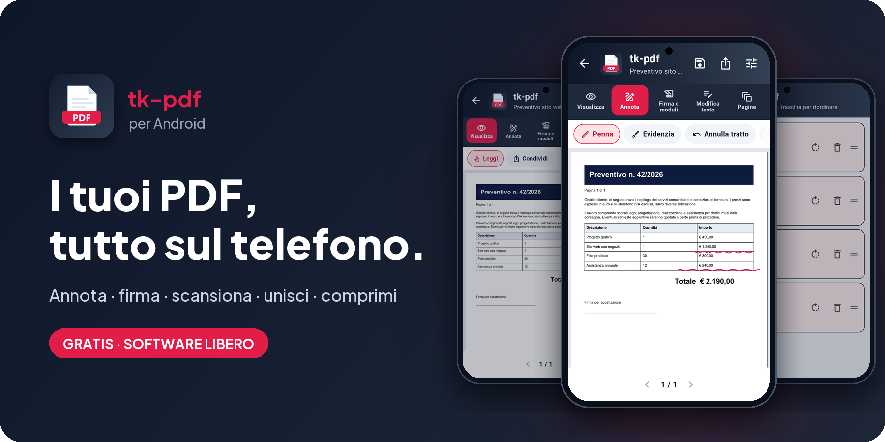
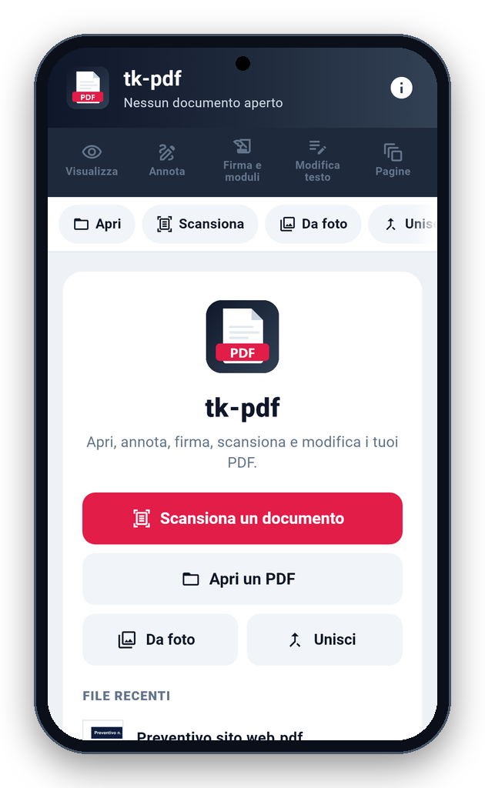
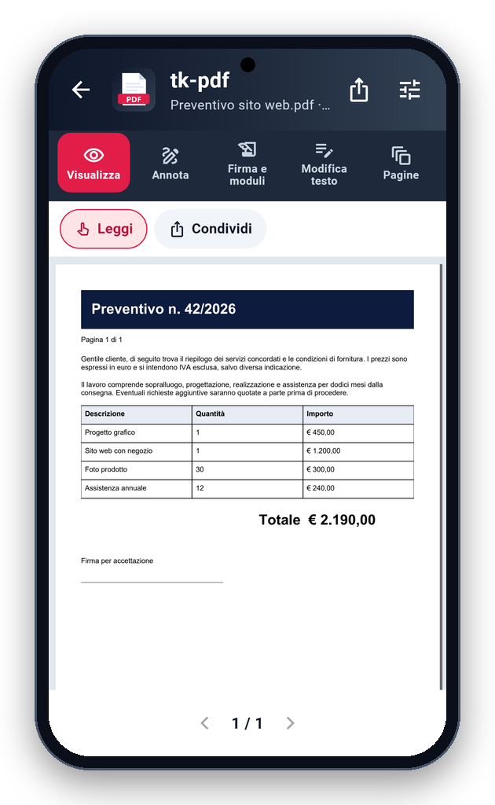
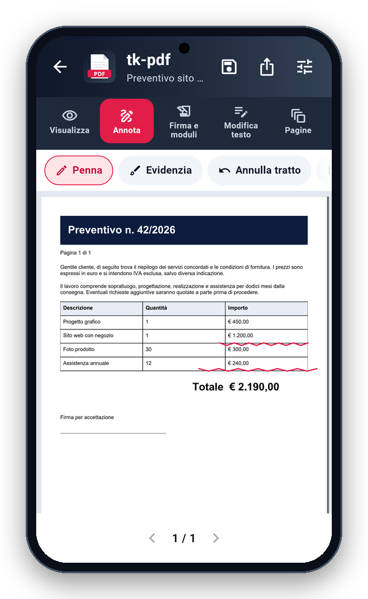
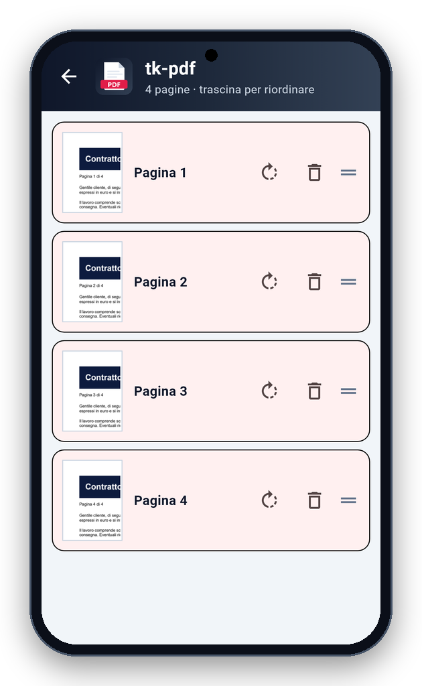

<!-- README generato da Dropbox/CLAUDE/dev/agpl-rollout/readme/genera_readme_app.py: modificare lì -->
<div align="center">



<br><br>

<a href="https://play.google.com/store/apps/details?id=it.pietrodefilippis.tkpdf"></a> &nbsp; <a href="https://pietrodefilippis.it/donazione/"></a>

<br><br>

<a href="COPYING"></a>   

</div>

---

## ✨ Cosa fa

<table>
<tr>
<td width="50%" valign="top">

### 📖&nbsp; Leggi e condividi
Apri i PDF dal telefono, dalle email o dalle app di archiviazione, e condividili.

</td>
<td width="50%" valign="top">

### 🖊️&nbsp; Annota a dito
Scrivi e disegna con la penna, evidenzia il testo.

</td>
</tr>
<tr>
<td width="50%" valign="top">

### ✍️&nbsp; Firma e moduli
Firma con il dito e compila i moduli.

</td>
<td width="50%" valign="top">

### 📷&nbsp; Scansiona
Fogli di carta in PDF con la fotocamera: i bordi si trovano da soli e il testo viene riconosciuto.

</td>
</tr>
<tr>
<td width="50%" valign="top">

### 📑&nbsp; Pagine
Unisci più PDF; ruota, riordina trascinando ed elimina le pagine.

</td>
<td width="50%" valign="top">

### 🔐&nbsp; Modifica e proteggi
Correggi il testo del documento, comprimi i file pesanti e salvali con password.

</td>
</tr>
</table>

## 📱 Com'è fatta

<div align="center">

<table align="center">
<tr>
<td align="center" valign="top"><br><sub><b>Home</b></sub></td>
<td align="center" valign="top"><br><sub><b>Lettura</b></sub></td>
<td align="center" valign="top"><br><sub><b>Annota</b></sub></td>
</tr>
<tr>
<td align="center" valign="top"><br><sub><b>Pagine</b></sub></td>
</tr>
</table>

</div>

## 🔒 I tuoi dati

- **Privacy:** documenti e dati restano sul telefono: non vengono caricati da nessuna parte. Le statistiche anonime (una volta al giorno: nome, versione, sistema e un codice casuale) partono solo se dici sì nel benvenuto o in Informazioni.
- **Permesso aggiuntivo per le librerie:** Syncfusion Flutter PDF e Google ML Kit, vedi [ECCEZIONE-LICENZA.md](ECCEZIONE-LICENZA.md) (AGPL sez. 7).

Nessuna pubblicità, nessun account da creare, nessun abbonamento: tutte le funzioni sono gratis, per tutti.

## 📥 Installazione

- **Android** — da [Google Play](https://play.google.com/store/apps/details?id=it.pietrodefilippis.tkpdf): si installa e si aggiorna come ogni altra app.
- **Piattaforme:** Android e iPhone. C'è anche per Windows e Mac: [tk-pdf per computer](https://pietrodefilippis.it/software/).

<details>
<summary><b>🛠️ Compilare dal codice sorgente</b></summary>

<br>

Serve [Flutter](https://flutter.dev) (versione indicata in `.github/workflows/android.yml`):

```bash
flutter pub get
flutter test
flutter build apk --release
```

Senza la variabile `ANDROID_KEYSTORE` l'APK si firma con la chiave di debug di Flutter.

</details>

## 📜 Licenza

**tk-pdf** è software libero: © 2026 Pietro De Filippis (TecnikGeek), licenza
**[GNU Affero General Public License v3.0](COPYING)**. Puoi usarlo, studiarlo, modificarlo e condividerlo; è
fornito **così com'è, senza alcuna garanzia**.

> Il nome **tk-pdf** e il logo non sono coperti dalla licenza (AGPL, sezione 7): una versione modificata deve avere un nome diverso.

---

<div align="center">

**Ti è utile?** Tutte le funzioni sono gratis per tutti. Se vuoi, un caffè aiuta a migliorarla e a crearne altre.

<a href="https://pietrodefilippis.it/donazione/"></a>

<sub>Creata da <a href="https://pietrodefilippis.it">Pietro De Filippis · TecnikGeek</a> — Webmaster & UX/UI Designer</sub>

</div>
